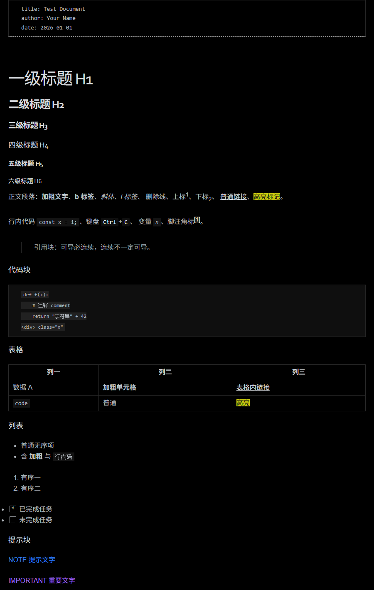

# Typora-modify

[](https://github.com/XLJFZ/Typora-modify/actions/workflows/theme-check.yml)

两个基于 Typora 内置 `night` 主题改造的**纯黑（OLED）主题**，外加一套让**导出 PDF 自动转白底**的解决方案。

内置 `night` 的背景是深灰 `#363B40`，不是纯黑；而且用深色主题直接导出 PDF，会得到一整页黑底。这个仓库解决这两件事。



| | `pure-black` | `pure-black-soft` |
|---|---|---|
| 定位 | 纯黑 + night 原始文字亮度，白天/大屏 | 纯黑 + 文字压一档，长时间写作 |
| 正文色 | `#B8BFC6` | `#B2B8BE` |
| 对纯黑对比度 | 11.31:1 | 10.49:1 |
| 背景 | `#000000` | `#000000` |

两版共享同一套缺陷修复，只是文字亮度差一档。

## 安装

1. Typora → 菜单 `主题` → `打开主题文件夹`
2. 把 `themes/` 下的**三个文件**一起复制进去：
   - `pure-black.css`
   - `pure-black-soft.css`
   - `pdf-white.css` ← 打印样式，被上面两个 `@import`，**不能少**
3. 重启 Typora，在 `主题` 菜单里选一个

> `night/` 子目录是 Typora 自带的（`themes/night/*.css`），不用额外准备。

## 导出 PDF 自动转白底

Typora 默认用**当前主题**导出 PDF。官方文档也写明 Windows / Linux 版「仅支持浅色主题导出 PDF」——所以深色主题导出就是黑底。

网上常见的做法是导出前手动切主题。这里换个思路：把打印样式接进主题本身。

```css
@import "pdf-white.css";   /* 内部全是 @media print 规则，屏幕不受影响 */
```

`@media print` 内的规则只在打印时生效，所以屏幕观感不变，而导出 PDF 会自动白底黑字。官方也推荐用 `@media print` 做 PDF 专属微调。

`preview/sample.pdf` 是实测导出结果：A4、白底、代码高亮转深色。

### 光有 `@media print` 还不够

`@media print` 里把背景刷白之后，暗色主题的一大堆浅色前景会直接消失。实测踩到四个：

| 问题 | 原因 | 处理 |
|---|---|---|
| 加粗文字几乎不可见 | 护眼版把 `strong` 压到 `#BCC2C8`，白纸上近乎消失 | print 内压回 `#222` |
| 任务列表成黑方块 | `input:before` 的深色底 + 黑边框，白底上就是实心块 | 改白底 + `#444` 边框 |
| 代码高亮全糊 | `night/codeblock.dark.css` 的 token 是 `#7DF46A` 这类亮色 | 逐类换深色 + `*` 兜底 |
| 引用块被拍平 | `pdf-white.css` 里有 `border:none !important` | 后面用同特异性 `!important` 恢复左边框 |

导出后全元素最低对比度 4.85:1（代码注释）。

## 配色设计

背景恒为 `#000`，灰面按层级压到近黑：

| 区域 | night | pure-black |
|---|---|---|
| 正文/编辑区 | `#363B40` | `#000000` |
| 侧边栏 | `#2E3033` | `#0A0A0A` |
| 代码块 / 气泡 | `#333` | `#0F0F0F` |
| 表格 / 引用边框 | `#474D54` | `#2A2A2A` |
| 分隔线 | `#474D54` | `#2E2E2E` |

### 三个容易漏的地方

改造暗色主题时，只替换 `#RRGGBB` 是不够的：

1. **CSS 命名色**。`night.css` 里 `h4` / `h6` 用的是 `color: white`，`.ty-table-edit` 用的 `border-top: 1px solid gray`，另有 3 处 `grey`。纯黑背景下 `white` 的标题（21:1）会比 `#DEDEDE` 的 h1~h3（14.94:1）还亮，**层级直接倒挂**。
2. **半透明遮罩**。`rgba(174,174,174,0.7)` 是模态遮罩，在纯黑上会变成一块刺眼浅灰。
3. **本身就是纯黑的值**。`background: black` 不需要改，但 `#1A1A1A` 的 `hr` 对 `#000` 只有 1.21:1 —— 等于画了条看不见的线。

`night` 主题还有一处原有缺陷：`mark {}` 只设了黄底 `#D3D40E` 却没设 `color`，文字继承正文浅灰，压在黄底上几乎读不出来。两个主题都补了 `color: #0f0f0f`。

## 脚本

```bash
pip install playwright          # 复用系统 Edge/Chrome，无需 playwright install

python scripts/build_themes.py                  # 从 night.css 重新生成，直接装回 Typora
python scripts/build_themes.py -o themes        # 生成到指定目录
python scripts/review_theme.py --css themes/pure-black.css
python scripts/audit_computed.py --css themes/pure-black.css
```

- **`build_themes.py`** — 唯一真源。改配色改它再重跑，不要手改生成的 css。
- **`review_theme.py`** — 静态审查：括号平衡、`@import` 可解析、命名色残留、中灰背景残留。
- **`audit_computed.py`** — 用 Playwright 读浏览器的 computed style，对 `screen` / `print` 两种媒体各算一遍对比度。层叠、`!important`、继承全由浏览器裁决，比手写正则猜可靠。

`audit_computed.py` 有两个坑值得记：读到的背景常是 `rgba(0,0,0,0)`，**必须按 alpha 与页面底色合成**，否则会把「8% 白叠加」误读成纯白；`hr` 屏幕用 `background` 画线、打印用 `border-top` 画线，取色要按实际生效的属性来。

## CI

`.github/workflows/theme-check.yml` 在每次 push 时跑一遍：静态审查 + 双媒体对比度审计 + 安装清单完整性检查。任何一项发现问题，构建直接失败。

注意 `build_themes.py` **不**在 CI 里跑 —— 它需要本机 Typora 的 `night.css` 作为基座，CI 上没有。所以改配色要本地生成后提交 `themes/` 下的产物。

## 已知限制

- 只测了 Windows + Typora 1.x。macOS / Linux 的主题目录路径脚本会自动探测，但没实测过。
- 主题从 Typora 内置 `night.css` **派生**，所以 `build_themes.py` 需要本机装 Typora；仓库不含 Typora 的原始 css。
- `pdf-white.css` 里的 `@page { size: A4; margin: 20mm }` 会强制 A4 纸张，改尺寸要动这个文件。

## License

MIT
